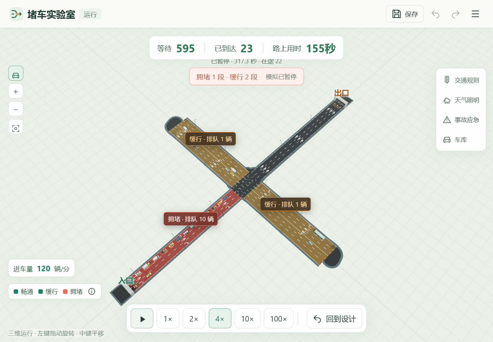
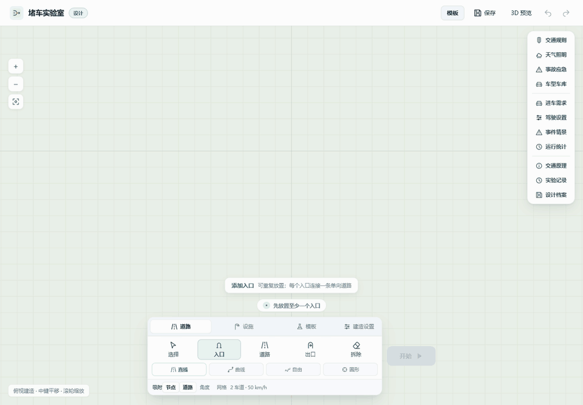
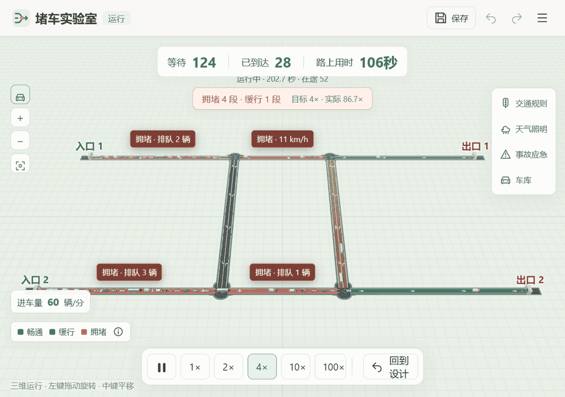
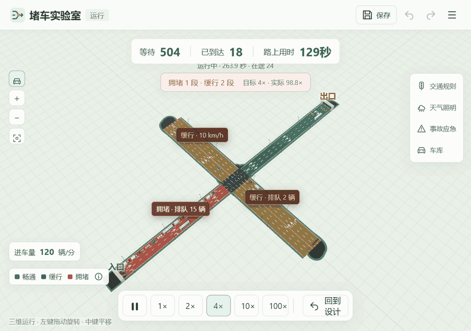
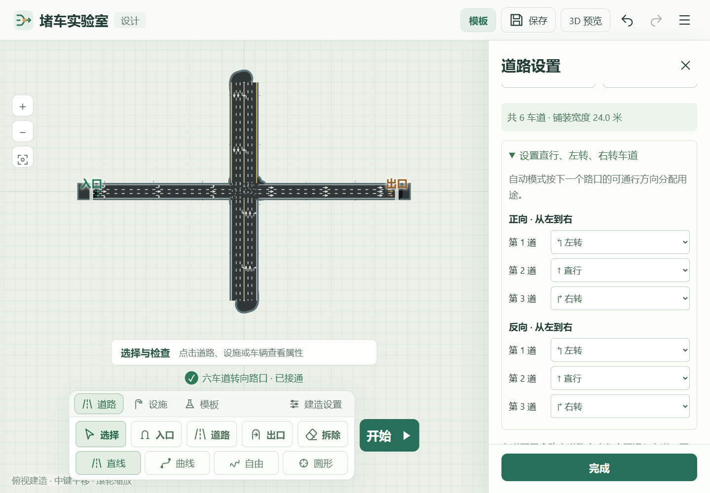
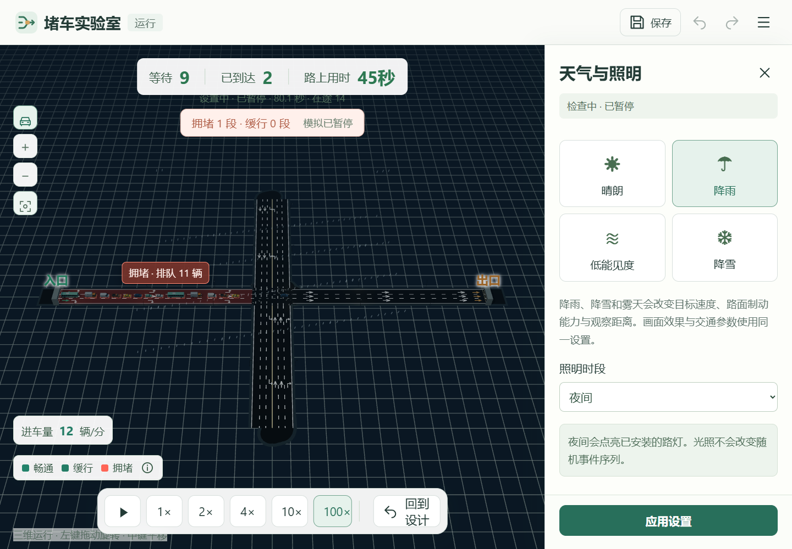
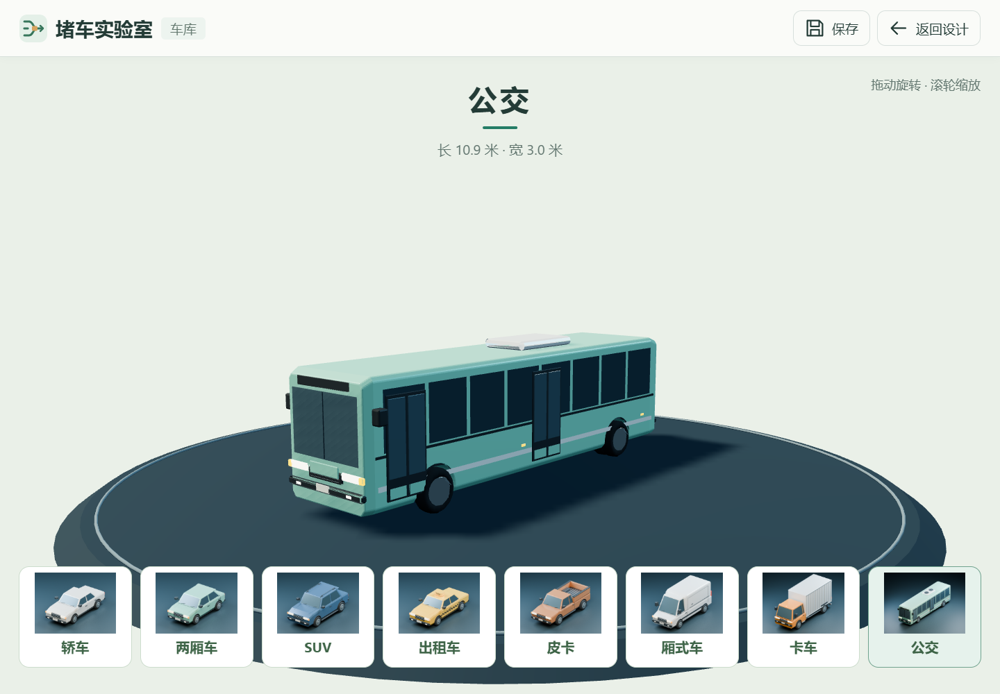

<div align="center">
  
  <h1>堵车实验室</h1>
  <p>在浏览器中设计路网，观察车流、信号与拥堵。</p>
  <p>Three.js · WebGL · JavaScript · MIT</p>
  <p><a href="#玩法演示">玩法演示</a> · <a href="#本地运行">本地运行</a> · <a href="#操作方式">操作方式</a> · <a href="#模型与参数">模型与参数</a></p>
</div>



从一条道路开始，逐步搭建交叉口、分岔和环岛。调整车道用途、进车需求与信号配时，比较道路结构和突发事件对通行的影响。全部模型和运行资源随仓库提供。

## 玩法演示

以下动图与截图均录制自实际应用。

### 自由建造



支持直线、曲线、自由道路和圆形道路。单向道路支持 1 至 16 车道，双向道路支持每个方向 1 至 8 车道；道路宽度随车道数量调整，路口按道路走廊与车辆转弯包络生成铺装。

### 多入口、多出口



入口和出口都可设置多个，运行时至少各有一个。每个端口连接一条单向道路，总进车量在各入口间分配，各入口独立排队。开启“司机知道出口位置”后，车辆先在可达出口中分配目标，再选择前往目标的最短路线；关闭后沿相邻道路探索，经任一出口完成行程。

### 信号与拥堵



调整绿灯时长、总进车量和逐道转向配置，观察排队、车速和到达数量的变化。内置模板提供信号均分与东西优先、20 km/h 与 60 km/h 瓶颈，以及 Braess 有捷径与无捷径布局，便于在相同需求和随机种子下进行对照。

## 车道、环境与车型

道路属性支持逐道配置左转、直行、右转与共享车道。自动模式依据路口的可通行方向分配车道用途。



天气与昼夜设置可切换场景环境；车库可查看八类车辆的三维模型。运行中还可注入车辆故障与碰撞，执行清障，并保存、导出本轮统计与设计。菜单“交通原理”提供三段可暂停的循环示意动画。

<p align="center">
  <a href="media/environment.png"></a>
  <a href="media/garage.png"></a>
</p>

## 本地运行

需要 **Node.js 20 或更高版本**。

```bash
git clone https://github.com/jiassia/traffic-laboratory.git
cd traffic-laboratory
npm ci
npm run build
npm start
```

启动后打开 [http://127.0.0.1:4173/](http://127.0.0.1:4173/)。

Windows 也可双击根目录的 `启动游戏.cmd`，首次启动会安装依赖并构建。开发模式使用 `npm run dev`。静态托管时上传构建生成的完整 `dist` 目录，保留其子目录结构。

## 操作方式

| 操作场景 | 操作 |
| --- | --- |
| 俯视建造 | 左键选择起点与终点，或拖动绘制 |
| 三维预览、运行与车库 | 左键拖动旋转视角 |
| 三维建造工具 | 左键建路，右键旋转视角 |
| 视角移动 | 中键平移，滚轮缩放 |
| 检查对象 | 选择工具单击道路、设施或车辆 |
| 撤销与重做 | `Ctrl Z`、`Ctrl Shift Z`；手机端使用菜单 |
| 保存设计 | `Ctrl S`，或使用菜单中的保存、导出 |
| 局部拆除 | 选择拆除工具查看范围，再点击确认 |

## 源码结构

```text
src/                 应用界面、仿真引擎与道路几何
assets/              车型、道具、预览图与图标
scripts/             构建与本地服务
media/               README 动图与截图
licenses/            第三方依赖许可
index.html           开发入口
package-lock.json    固定依赖版本
```

构建使用 esbuild，场景使用 Three.js 与浏览器 WebGL。仿真逻辑与渲染分离，车辆参数集中在 `src/vehicle-profiles.mjs`，道路与路口几何位于对应的 geometry、junction 模块。

## 模型与参数

模型采用米、秒等国际单位，使用 0.05 秒固定步长。在网车辆上限为 64 辆，超出预算的需求保留在入口队列中。车辆在入口和路口选择车道，当前版本尚未实现路段中途变道。

本项目用于交通原理教学和交互实验，参数未按特定地区的实测交通数据标定。参数来源与采用值见 [车辆参数模块](src/vehicle-profiles.mjs)。

## 许可与反馈

项目代码采用 [MIT License](LICENSE)。车辆资源采用 [CC0](assets/licenses/vehicles-CC0.txt)，模型字形保留 [字体许可](assets/licenses/props-font.txt)，Three.js 与 esbuild 的许可见 [licenses](licenses/)。

提交 [问题反馈](https://github.com/jiassia/traffic-laboratory/issues) 时，可附上浏览器版本、导出的设计 JSON 和复现步骤。
